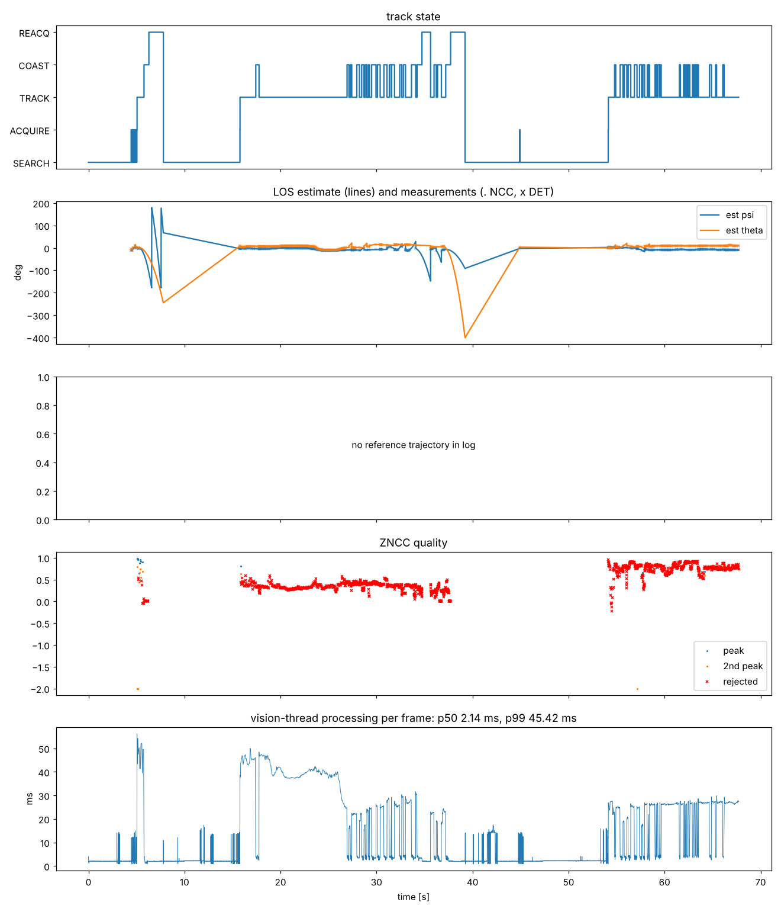

# 현장 run 1 — 템플릿 실패와 추정기 발산

- **날짜:** 2026-10-27
- **코드:** 첫 C++ 배포본. 저장소에는 이 상태가 따로 커밋돼 있지 않고, run 1 수정이 들어간 다음 상태가 `stage1-v2-cpp`입니다.
- **설정 (로그에 기록된 값):** `ncc.tmpl_max = 96`, `estimator.q_cv = 0.02`, `q_ca = 20`, `detector.thr_acquire = 0.6`, 노출 SEARCH 1 ms / TRACK 3 ms
- **조건:** 손에 든 스마트폰, 약 0.4 m (박스 중앙값 280 × 419 px)
- **원본:** `run1.rlog` (이 폴더). 클립은 기록하지 않음

## 수치 (`rcws_log.py`)

| 항목 | 값 |
|---|---|
| 길이 / 프레임 | 67.7 s / 5548 |
| 프레임 간격 중앙값 | 8.33 ms (120 fps, 드롭 0) |
| 처리 시간 전체 p50 / p99 | 2.1 / 45.4 ms |
| 처리 시간 TRACK 중 p50 / p99 | 26.6 / 49.4 ms (예산 8.33 ms의 3~6배) |
| 상태 점유율 | SEARCH 59.3%, ACQUIRE 0.6%, TRACK 19.8%, COAST 11.7%, REACQ 8.5% |
| Hailo 검출 지연 p50 / p99 | 9.75 / 11.10 ms |
| 검출 측정 수용률 | 67.7% (843회) |
| NCC 성공 | 1732회 중 24회 (1.4%), rho 중앙값 0.41, 템플릿 97 px |
| 추정 고각 범위 | −401° ~ 22° (발산) |

## 관찰과 원인

- 폰이 가까워 박스가 수백 px인데, 템플릿은 96 px 상한에 걸려 폰 화면의 무늬 없는 가운데만 잡았습니다. 어디에 맞춰도 점수가 비슷해 NCC가 거의 실패했습니다.
- 관측이 끊긴 COAST 동안 추정기가 제한 없이 외삽해 방위각이 ±180°를 돌고, 고각이 −401°까지 발산했습니다.
- 발산한 예측에 게이트를 걸어 정상 검출까지 탈락해 복구하지 못했습니다.

## 조치 (→ `stage1-v2-cpp`)

물체 전체를 덮는 피라미드 템플릿, COAST 외삽 50 ms 제한 후 속도 감쇠, 고각 ±90° 클램프, 0.25 s 이상 끊기면 필터 재초기화, 게이트를 제한된 예측 기준으로 계산.
