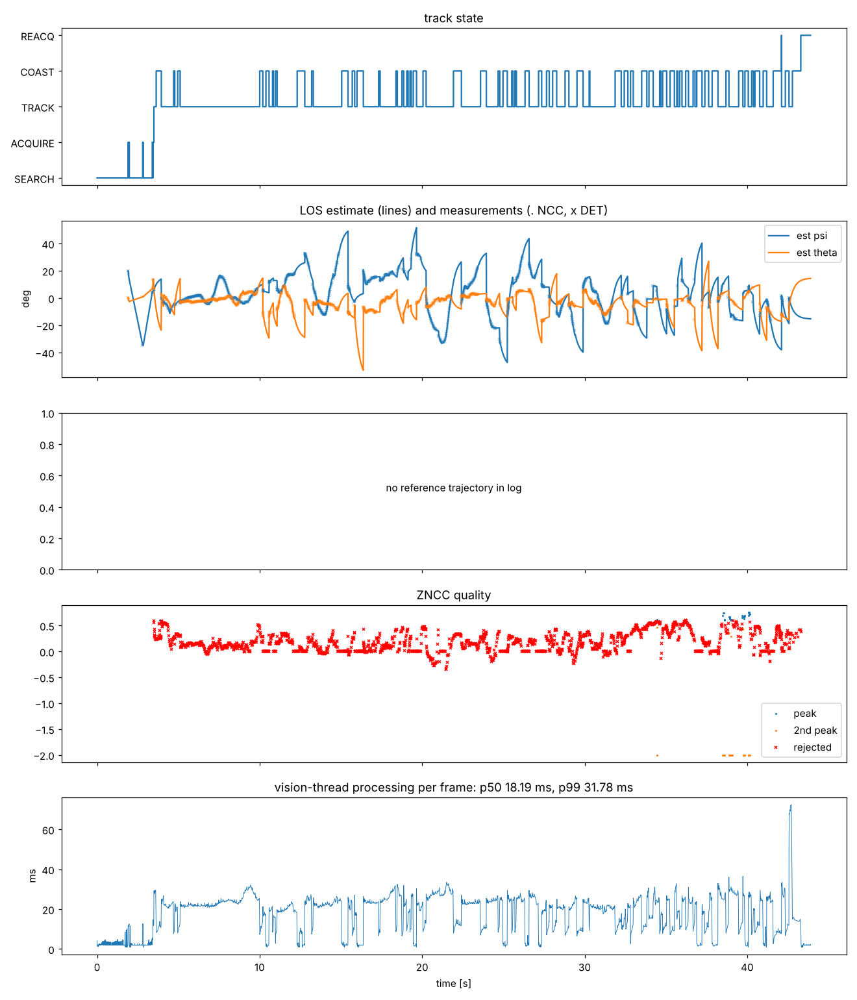

# 현장 run 2 — 실효 60 fps, NCC 실패, 검출 게이트 탈락

- **날짜:** 2026-10-28
- **코드:** `stage1-v2-cpp` (run 1 수정 반영)
- **설정 (로그에 기록된 값):** `ncc.tmpl_max = 96`, `estimator.q_cv = 0.02`, `q_ca = 20`, `detector.thr_acquire = 0.45`, 노출 TRACK 3 ms
- **조건:** 손에 든 스마트폰, 0.4~1 m (박스 중앙값 206 × 343 px), 손 움직임 중앙값 약 34°/s, 약 400°/s²
- **원본:** `run2.rlog` (이 폴더). 클립은 기록하지 않음

## 수치 (`rcws_log.py`)

| 항목 | 값 |
|---|---|
| 길이 / 프레임 | 43.9 s / 2631 |
| 프레임 간격 중앙값 | 16.65 ms (실효 60 fps, 목표 120 fps) |
| 처리 시간 전체 p50 / p99 | 18.2 / 31.8 ms |
| 처리 시간 TRACK 중 p50 / p99 | 23.3 / 33.1 ms |
| 상태 점유율 | SEARCH 14.9%, ACQUIRE 1.0%, TRACK 52.1%, COAST 29.4%, REACQ 2.6% |
| Hailo 검출 지연 p50 / p99 | 9.58 / 10.75 ms |
| 검출 측정 수용률 | 52.8% (1725회, 확신도 중앙값 0.81, d² 중앙값 8.0) |
| NCC 성공 | 2139회 중 44회 (2.1%), rho 중앙값 0.15, 템플릿 59 px |
| 추정 방위각 / 고각 범위 | −47° ~ 52° / −53° ~ 27° (발산 없음) |

## 관찰과 원인

run 1의 발산은 사라졌지만 세 가지가 겹쳐 추적이 계속 COAST로 무너졌습니다.

1. **처리 시간:** NCC가 탐색창마다 864 px 영역을 새로 축소했고, 큰 ROI를 메인 스트림에서 RGB로 변환했습니다. 프레임당 23 ms로 120 fps 예산을 넘어 60 fps로 떨어졌습니다.
2. **NCC 창:** 템플릿 원점과 탐색창이 축소 격자에서 어긋나 같은 물체도 rho가 낮게 나왔습니다.
3. **모션 모델:** 공정 잡음 q가 손 움직임에 비해 작아, 확신도 높은 검출의 절반 가까이를 외란으로 판정해 버렸습니다.

## 조치 (→ `field-run2-fixes`, `stage1-v3.1-run2`)

NCC 축소 영상 프레임당 1회 캐시, 템플릿 원점 격자 스냅, 예측 불확실도가 크면 NCC 생략, NCC 잡음에 축소 배율 반영, 큰 ROI는 lores에서 크롭, q_cv 5 / q_ca 500, 강한 검출이 3회 연속 탈락하면 재고정. 같은 조건을 합성 회귀 시험으로 추가했습니다.
