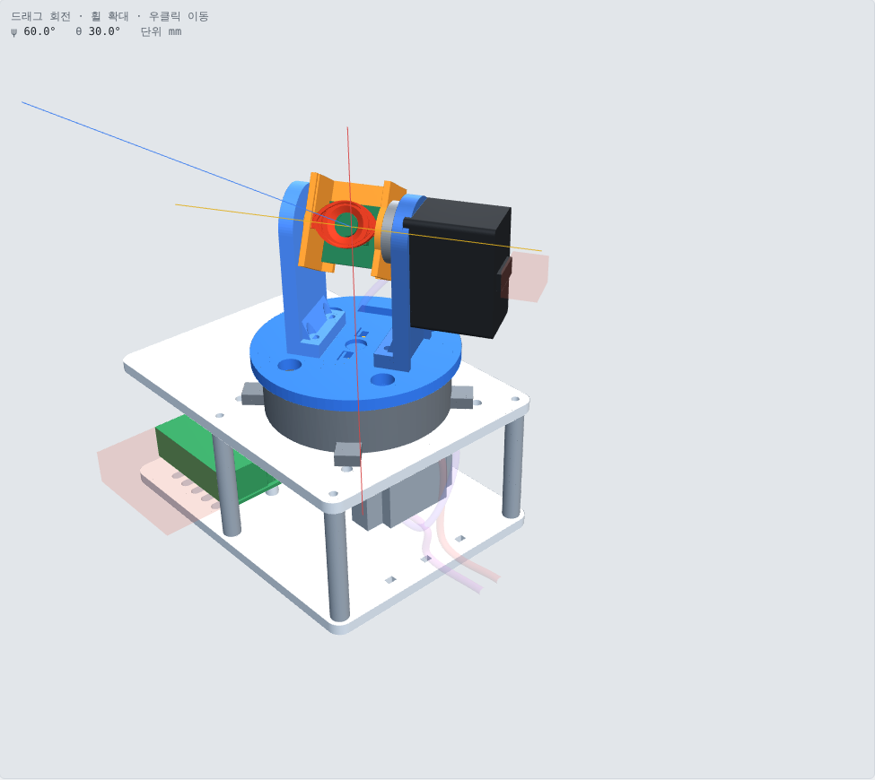
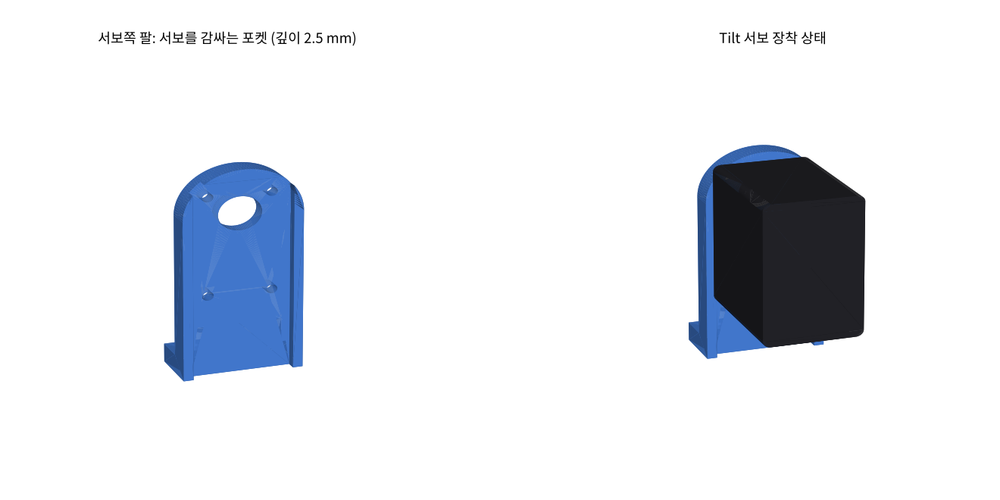
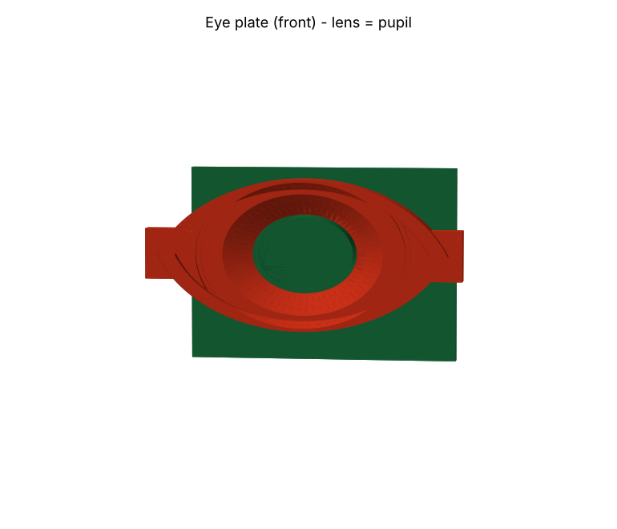

# 상단부 2축 Pan-Tilt 짐벌 기구 (v0.4)

카메라가 표적을 따라 좌우(Pan)·상하(Tilt)로 회전하는 상단부 기구입니다. CadQuery 파라메트릭 소스로 만들고, CATIA용 STEP과 3D 프린터용 STL로 내보냅니다. 버전별로 왜 구조를 바꿨는지는 이 폴더의 커밋 기록에 남아 있습니다(`git log -- mechanical`).



> **상태: 출력 검증 전.** 서보·카메라·Pi 치수는 실측 전 가정값입니다([확인이 필요한 치수](#확인이-필요한-치수)).

## 설계 특징

- **구매 부품 최소화:** 볼베어링은 6806 한 개, 나사는 M3 × 10 한 종류(19개)로 통일했습니다. 나머지는 출력물로 대체했습니다.
  - Tilt 반대쪽 베어링은 예압을 준 출력물 부싱입니다.
  - Pi와 카메라 고정 나사는 출력물 돌기를 인두로 눌러 고정하는 방식(열 코킹)입니다.
- **서보 축 보호:** Pan 회전부 무게는 6806 베어링이 받고, 서보는 핀–홈 커플러를 통해 회전 토크만 전달합니다.
- **유격 제거:** 커플러 홈 한쪽 벽을 출력물 스프링(예압 0.15 mm)으로 만들어 Pan 백래시를 없앴습니다.
- **반작용 토크 지지:** Tilt 서보 몸체를 팔의 포켓이 감싸, 모터 반작용 토크를 나사가 아닌 형상으로 받습니다.
- **케이블 관리:** 턴테이블 아래 환형 채널에 케이블을 감아 두는 방식(clock-spring)으로 Pan ±150°(하드 스토퍼 ±168°)를 지원합니다.
- **설계공간 자동 탐색:** 채널 반경, 스토퍼 형식, Tilt 서보 방향, 높이 조합 48개를 자동 생성해 간섭, 화각 가림, Pan 관성, 무게중심으로 평가했습니다(`explore_v03.py`).
- **카메라 눈 장식판:** 렌즈가 동공 자리에 오는 0.3 g 장식판입니다. 화각 가림 0 %, Tilt 무게중심은 오히려 축 쪽으로 옮겨집니다.

| Tilt 서보 포켓 | 눈 장식판 |
|---|---|
|  |  |

## 버전 기록

| 버전 | 주요 변경 | 이유 |
|---|---|---|
| v0.1 (`gimbal.py`) | 첫 초안. 렌즈 중심을 Pan·Tilt 축 교점에 배치 | 회전해도 시선 원점이 움직이지 않게 |
| v0.2 (`gimbal_v02.py`) | 6806 베어링 지지, 핀–홈 커플러, 케이블 환형 채널, 스토퍼 | 회전부 무게·기울임 모멘트가 Pan 서보 축에 걸려 마모·유격이 생기는 구조를 해소 |
| v0.3 (`gimbal_v03.py`) | 48개 후보 자동 탐색으로 채널 R36, 홈+러그 스토퍼, Tilt 서보 아래 방향 확정 | 서로 얽힌 변수를 근거 있게 고르기 위해. 목표는 모터를 혹사하지 않는 빠른 반응성 |
| v0.4 (`gimbal_print.py`) | 출력용 분할, 부품 규격 통일, 출력 부싱·스프링 커플러, 눈 장식판, Tilt 서보 포켓 | 3D 프린팅 조립과 구매 부품 최소화. Tilt 서보 고정 구멍 버그 수정 |
| v0.4 수정 | 서보 커넥터 뒷면 중앙, 케이지 바닥 구멍, 하판 통풍 슬롯, 하판+기둥 일체형 선택지 | 실물 커넥터 위치 반영, Pi 냉각과 추가 배선 |

이전 버전 파일은 비교를 위해 그대로 두었습니다. 현재 형상은 `gimbal_v03.py` + `gimbal_print.py`가 만듭니다.

## 파일

```text
mechanical/
  gimbal.py, gimbal_v02.py     v0.1, v0.2 형상 생성기 (기록용)
  gimbal_v03.py                현재 형상 생성기 (모든 치수·공차 파라미터)
  gimbal_print.py              출력용 분할·방향 지정·STEP/STL 내보내기
  explore_v03.py               설계공간 탐색
  recheck_v03.py               최종 후보 재검사 (시선 하향 한계, 시스템 무게중심)
  metrics_v04.py               Tilt축 높이 79 mm 유지 vs 63 mm 비교
  publish_v04.py               3D 뷰어 HTML 생성
  docs/PRINT_GUIDE.md          출력·조립 가이드
```

STEP·STL·뷰어 같은 생성 파일은 용량이 커서 저장소에 커밋하지 않고 GitHub Releases에 묶음으로 올립니다. 소스만 있으면 아래 명령으로 똑같이 다시 만들 수 있습니다.

## 사용법

```bash
pip install -r requirements.txt
cd mechanical
python gimbal_print.py     # print_v04/ 생성 (STEP, STL, 출력 보고서)
python publish_v04.py      # viewer/rcws_gimbal_viewer_v04.html 생성
```

- **CATIA:** File → Open → `print_v04/RCWS_gimbal_v04_assembly.step`. 부품마다 CATPart가 만들어진 CATProduct로 열립니다.
- **출력:** `print_v04/stl/*_print.stl`을 슬라이서에 올리고 판 가운데로 정렬합니다. 순서와 설정은 [출력 가이드](docs/PRINT_GUIDE.md)를 따릅니다.
- **공차와 높이:** 공차는 `gimbal_v03.py`의 `FIT_SHAFT`, `FIT_BORE`로, Tilt축 높이는 `gimbal_print.py`의 `H_TILT_KEEP`으로 바꿉니다.

## 확인이 필요한 치수

- STS3215 몸체 크기(45.2 × 24.7 × 35 mm 가정), 케이스 나사 구멍 위치, 뒷면 중앙 커넥터 크기
- 혼 지름(24 mm)과 혼 나사 원주 반지름(8 mm)
- Camera Module 3 Wide 장착 구멍 간격(21 × 12.5 mm)과 렌즈 중심
- Pi 5 + 쿨러 + AI HAT+ 스택 높이(30 mm)
- 히트셋 인서트 구멍(Ø 4.2 mm)

## 라이선스

- 코드(`*.py`, `viewer/`): [MIT](LICENSE)
- 설계 파일(STEP, STL, 이미지): [CC BY-NC-SA 4.0](LICENSE-DESIGN.md)
