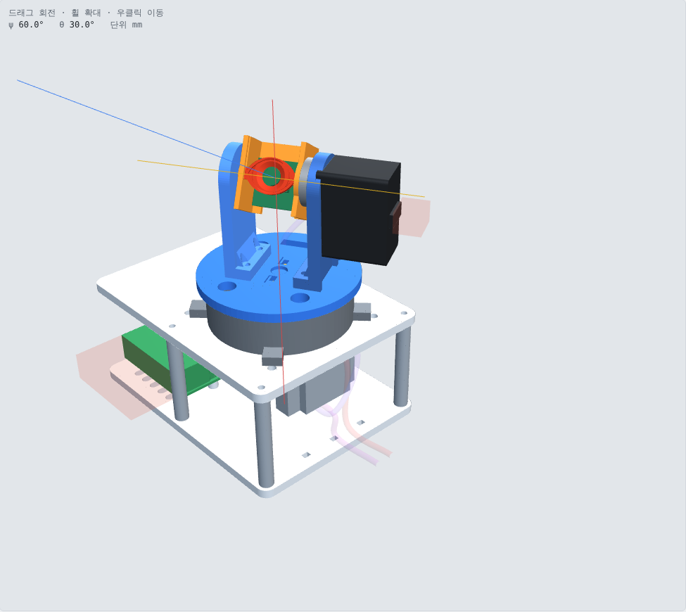
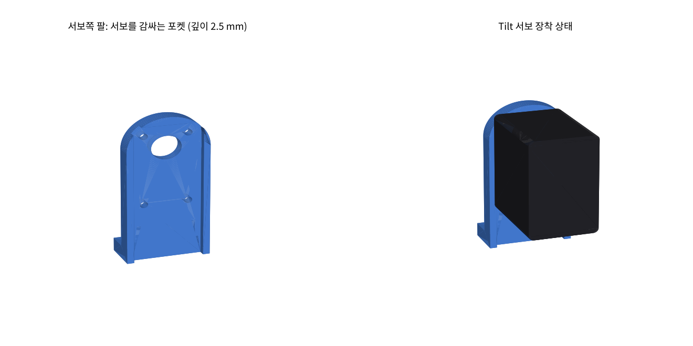
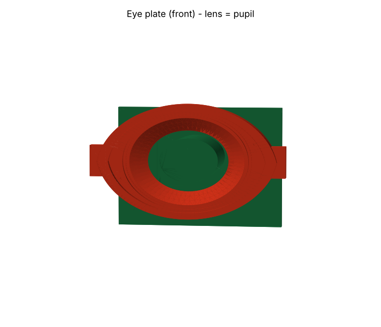
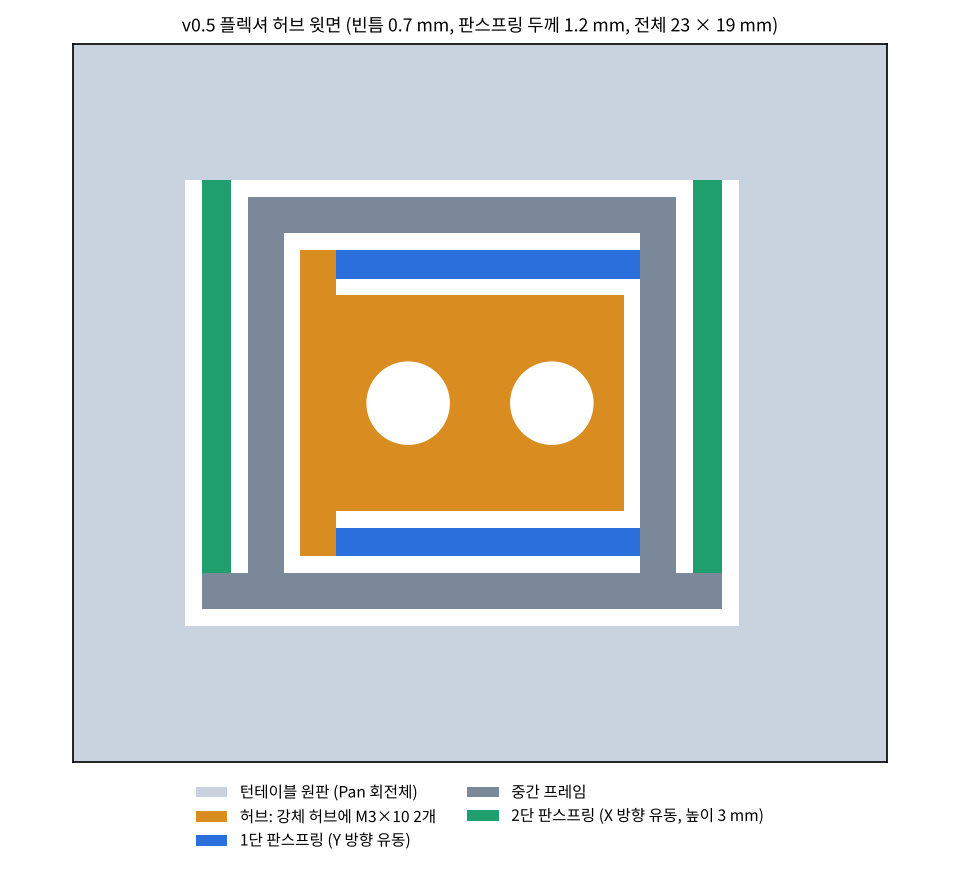

# 상단부 2축 Pan-Tilt 짐벌 기구 (v0.5)

카메라가 표적을 따라 좌우(Pan)·상하(Tilt)로 회전하는 상단부 기구입니다. CadQuery 파라메트릭 소스로 만들고, CATIA용 STEP과 3D 프린터용 STL로 내보냅니다. 버전별로 왜 구조를 바꿨는지는 이 폴더의 커밋 기록에 남아 있습니다(`git log -- mechanical`).



> **상태: 출력 검증 전.** 서보·카메라·Pi 치수는 실측 전 가정값입니다([확인이 필요한 치수](#확인이-필요한-치수)).

## 설계 특징

- **구매 부품 최소화:** 볼베어링은 6806 한 개, 나사는 M3 × 10 한 종류(25개)와 M3 너트(21개)로 통일했고 히트셋 인서트는 없앴습니다. 나머지는 출력물로 대체했습니다.
  - Tilt 반대쪽 베어링은 예압을 준 출력물 부싱입니다.
  - Pi와 카메라 고정 나사는 출력물 돌기를 인두로 눌러 고정하는 방식(열 코킹)입니다.
- **서보 축 보호:** Pan 회전부 무게는 6806 베어링이 받고, 서보는 회전 토크만 전달합니다.
- **유격 없는 Pan 구동 (v0.5):** 혼 → 강체 허브(M3 4개) → 플렉셔 허브(M3 2개) → 턴테이블로 토크 경로 전체가 볼트 체결 또는 한 몸 출력입니다. 플렉셔는 판스프링 두 쌍으로 축 어긋남만 흡수하므로 미끄럼 틈도, 시간이 지나며 풀리는 스프링 예압도 없습니다.
- **축 정렬 (v0.5):** 베어링 마운트 바닥이 서보 출력 보스에 직접 끼워져, 6806과 서보 축이 같은 기준면을 씁니다.
- **관통 볼트 체결 (v0.5.1):** 출력물끼리 잇는 곳은 전부 M3 × 10 볼트가 부품을 관통해 너트로 조입니다(케이지·마운트→상판, 기둥→상·하판, 팔→턴테이블, 플렉셔 허브→강체 허브). 너트는 출력물 육각 홈이나 옆에서 밀어 넣는 슬롯에 들어가 돌지 않으므로 공구로 잡을 필요가 없습니다. 금속 나사산에 바로 들어가는 곳(서보 혼 8개, Tilt 서보 케이스 4개)만 예외입니다.
- **반작용 토크 지지:** Tilt 서보 몸체를 팔의 포켓이 감싸, 모터 반작용 토크를 나사가 아닌 형상으로 받습니다.
- **케이블 관리:** 턴테이블 아래 환형 채널에 케이블을 감아 두는 방식(clock-spring)으로 Pan ±150°(하드 스토퍼 ±168°)를 지원합니다.
- **설계공간 자동 탐색:** 채널 반경, 스토퍼 형식, Tilt 서보 방향, 높이 조합 48개를 자동 생성해 간섭, 화각 가림, Pan 관성, 무게중심으로 평가했습니다(`explore_v03.py`).
- **카메라 눈 장식판:** 렌즈가 동공 자리에 오는 0.6 g 장식판입니다. v0.5에서 동공을 Ø 14.4 → Ø 16.8 mm로 넓혔고, 화각 가림은 0 %입니다.

| Tilt 서보 포켓 | 눈 장식판 (v0.5) | 플렉셔 허브 (v0.5) |
|---|---|---|
|  |  |  |

### Pan 구동 방식 비교 (v0.5 결정 근거)

6806과 서보 축이 각각 회전 중심을 정하므로, 두 축 사이 어긋남 e가 있으면 각도 θ에서 두 몸체 사이에 2e·sin(θ/2)만큼 강제 변위가 생깁니다(±150°에서 약 1.9e). 그래서 혼을 턴테이블에 바로 볼트로 묶으면 서보 축과 베어링이 서로 비틀어 당깁니다. 이 변위를 흡수할 요소는 반드시 있어야 하고, 그 요소에서 유격을 없애는 것이 핵심입니다.

| 방식 | 유격 | 축 어긋남 | 비고 |
|---|---|---|---|
| 혼 직결 (볼트) | 없음 | 흡수 못 함 | 출력물 오차 0.1~0.3 mm로도 서보 축에 수십~수백 N |
| v0.4 핀–홈 + 출력 스프링 | 이론상 없음 | 핀이 미끄러지며 흡수 | 스프링 예압 0.15 mm가 PLA 크리프로 줄면 유격이 다시 생김. 한 방향 토크는 Ø 3 출력 핀 하나가 받음 |
| **v0.5 2단 플렉셔 허브** | 없음 (접촉 없음) | 판스프링 굽힘으로 흡수 | 비틀림 강성 추정 약 66 N·m/rad (Pan 관성 1.3 × 10⁻⁴ kg·m²에서 공진 약 110 Hz, 서보 대역 약 6 Hz의 18배). 반경 강성 약 7~30 N/mm, 축 방향 약 46 N/mm |

플렉셔 수치는 판스프링 보 이론(PLA E = 3.5 GPa) 추정값이며, 실측은 sysid 펌웨어의 처프 응답에서 공진 피크로 확인합니다.

## 버전 기록

| 버전 | 주요 변경 | 이유 |
|---|---|---|
| v0.1 (`gimbal.py`) | 첫 초안. 렌즈 중심을 Pan·Tilt 축 교점에 배치 | 회전해도 시선 원점이 움직이지 않게 |
| v0.2 (`gimbal_v02.py`) | 6806 베어링 지지, 핀–홈 커플러, 케이블 환형 채널, 스토퍼 | 회전부 무게·기울임 모멘트가 Pan 서보 축에 걸려 마모·유격이 생기는 구조를 해소 |
| v0.3 (`gimbal_v03.py`) | 48개 후보 자동 탐색으로 채널 R36, 홈+러그 스토퍼, Tilt 서보 아래 방향 확정 | 서로 얽힌 변수를 근거 있게 고르기 위해. 목표는 모터를 혹사하지 않는 빠른 반응성 |
| v0.4 (`gimbal_print.py`) | 출력용 분할, 부품 규격 통일, 출력 부싱·스프링 커플러, 눈 장식판, Tilt 서보 포켓 | 3D 프린팅 조립과 구매 부품 최소화. Tilt 서보 고정 구멍 버그 수정 |
| v0.4 수정 | 서보 커넥터 뒷면 중앙, 케이지 바닥 구멍, 하판 통풍 슬롯, 하판+기둥 일체형 선택지 | 실물 커넥터 위치 반영, Pi 냉각과 추가 배선 |
| v0.5 (11/9) | 케이지·마운트 관통 볼트 + 너트, 2단 플렉셔 Pan 구동, 서보 보스 기준 정렬, 눈 동공 확대, 확인 쿠폰 | 체결 강성, 스프링 예압 크리프에 의한 유격 재발 방지, 축 어긋남 축소 |
| v0.5.1 (11/9) | 나머지 출력물 체결도 관통 볼트 + 너트로(기둥 Ø 8 → 10, 팔·허브는 옆 슬롯 너트), 인서트 0개. 팔 볼트 구멍이 보강판에 막히던 v0.4 버그 수정 | 모든 체결을 눈으로 확인 가능한 볼트·너트로 통일(사용자 요청). PLA 나사산·인서트 의존 제거 |

이전 버전 파일은 비교를 위해 그대로 두었습니다. 현재 형상은 `gimbal_v03.py` + `gimbal_print.py`가 만듭니다.

## 파일

```text
mechanical/
  gimbal.py, gimbal_v02.py     v0.1, v0.2 형상 생성기 (기록용)
  gimbal_v03.py                현재 형상 생성기 (모든 치수·공차 파라미터)
  gimbal_print.py              출력용 분할·방향 지정·STEP/STL 내보내기
  explore_v03.py               설계공간 탐색
  recheck_v03.py               최종 후보 재검사 (시선 하향 한계, 시스템 무게중심)
  metrics_v04.py               Tilt축 높이 79 mm 유지 vs 63 mm 비교
  checks_v05.py                v0.5 검수: 볼트·너트 포함 정적 간섭, Pan/Tilt 스윕, 스토퍼, 화각, 플렉셔 유동 여유
  publish_v05.py               3D 뷰어 HTML 생성 (publish_v04.py는 기록용)
  docs/PRINT_GUIDE.md          출력·조립 가이드
```

STEP·STL·뷰어 같은 생성 파일은 용량이 커서 저장소에 커밋하지 않고 GitHub Releases에 묶음으로 올립니다. 소스만 있으면 아래 명령으로 똑같이 다시 만들 수 있습니다.

## 사용법

```bash
pip install -r requirements.txt
cd mechanical
python gimbal_print.py     # print_v05/ 생성 (STEP, STL, 출력 보고서)
python checks_v05.py       # 간섭·스윕·화각 검수 -> checks_v05.json
python publish_v05.py      # viewer/gimbal_viewer_v05.html 생성
```

- **CATIA:** File → Open → `print_v05/gimbal_v05_assembly.step`. 부품마다 CATPart가 만들어진 CATProduct로 열립니다.
- **출력:** `print_v05/stl/*_print.stl`을 슬라이서에 올리고 판 가운데로 정렬합니다. 순서와 설정은 [출력 가이드](docs/PRINT_GUIDE.md)를 따릅니다.
- **공차와 높이:** 공차는 `gimbal_v03.py`의 `FIT_SHAFT`, `FIT_BORE`로, Tilt축 높이는 `gimbal_print.py`의 `H_TILT_KEEP`으로 바꿉니다.

## 확인이 필요한 치수

- STS3215 몸체 크기(45.2 × 24.7 × 35 mm 가정), 케이스 나사 구멍 위치, 뒷면 중앙 커넥터 크기
- 혼 지름(24 mm), 혼 나사 원주 반지름(8 mm)과 나사산(M3 탭 가정), 혼 위면 높이(서보 윗면 + 8 mm)
- 서보 출력 보스 지름(9 mm)과 그 주변 윗면이 평평한지 (베어링 마운트 정렬 기준)
- Camera Module 3 Wide 장착 구멍 간격(21 × 12.5 mm)과 렌즈 중심
- Pi 5 + 쿨러 + AI HAT+ 스택 높이(30 mm)
- M3 너트 육각 홈·슬롯 폭(맞변 5.8 mm, 확인 쿠폰으로 결정)

## 라이선스

- 코드(`*.py`, `viewer/`): [MIT](LICENSE)
- 설계 파일(STEP, STL, 이미지): [CC BY-NC-SA 4.0](LICENSE-DESIGN.md)
