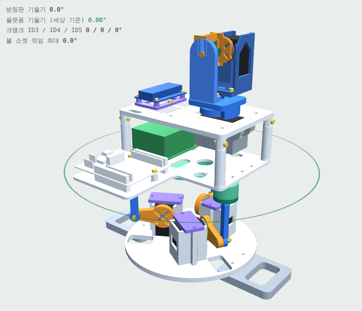
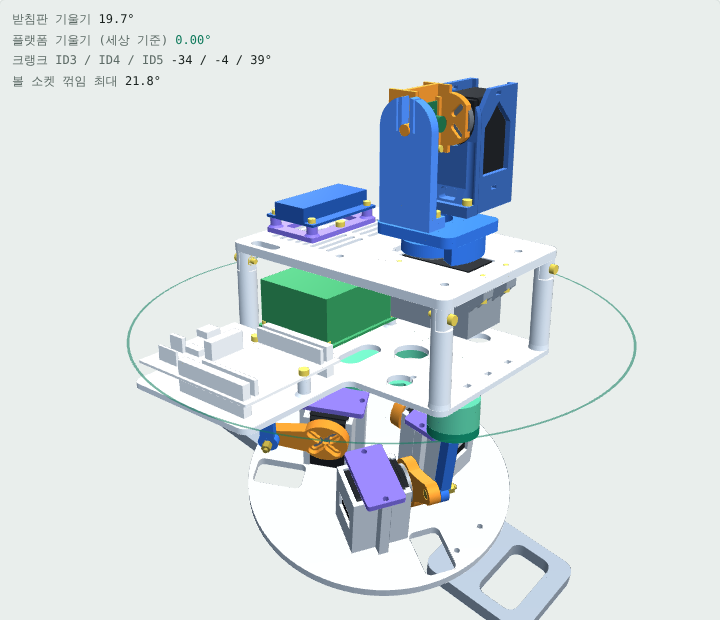
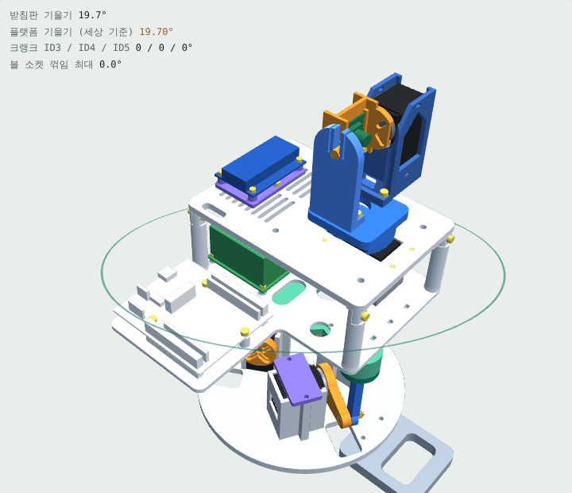

# Stage 2 v0.1 — 하단부 3축 수평 유지 플랫폼 (3-RRS)

받침판을 손으로 기울여도 STS3215 세 개가 플랫폼을 수평으로 되돌려, 위에 고정한 상단부 2축 짐벌(v0.9.2-S 플랜 B)을 평평하게 유지합니다. 수평 센서는 플랫폼 아래의 BNO085입니다.

- 생성: `cd stage2 && python s2_kin.py && python stage2.py` → `stage2_v01_package/` (+ zip)
- 뷰어: `python publish_s2.py` → `viewer/stage2_viewer_s2v01.html` (받침판 기울임 슬라이더로 역기구학이 움직임)

## 결정 사항 (11/20)

| 항목 | 결정 |
|---|---|
| 구조 | 3-RRS 병렬 플랫폼: Roll · Pitch · 높이 3자유도. Yaw는 상단부 Pan이 맡음 |
| 구동기 | STS3215 3개 (ID 3·4·5), 상단부와 같은 버스 |
| 외란 | 받침판을 손으로 기울임 (손잡이 2개) |
| 위에 올리는 것 | v0.9.2-S 플랜 B. 하판에 구멍 5개만 추가, 나머지는 그대로 |
| 수평 센서 | BNO085 1개, 플랫폼 아래 (기울어진 만큼을 직접 잼) |

## 기구학 치수 (`stage2/s2_kin.py`)

| 기호 | 값 | 뜻 |
|---|---|---|
| RB | 35 mm | 서보 축의 반경 (중심 → 축) |
| HS | 34 mm | 축 높이 (서보가 먼 쪽 끝으로 받침판에 섬: 45.2 − 11.2) |
| A | 35 mm | 크랭크 (축 → 핀) |
| L | 60 mm | 로드 (핀 → 볼 중심) |
| RP | 70 mm | 볼 중심 반경 (플랫폼) |
| T_OFF | 12.7 mm | 로드 면이 서보 축 면에서 접선 방향으로 떨어진 거리 |
| 다리 방향 | 90°, 210°, 330° | 손잡이는 0°, 180° |

치수 검토는 RB 30~50, A 22~40, L 50~66 범위를 훑어서 골랐습니다. A가 짧으면(25 mm) ±20°에서 크랭크가 거의 특이점(로드와 일직선)에 닿습니다. A = RB = 35가 각도 범위와 크기의 균형점입니다.

| 결과 (높이 ±3 mm 포함) | ±15° | ±20° |
|---|---|---|
| 크랭크 각 | −37.3 ~ +37.8° | −50.1 ~ +52.2° |
| 볼 소켓 꺾임 최대 (한계 30°) | 18.6° | 26.8° |
| 크랭크-로드 전달각 (90°가 최선) | 49 ~ 124° | 31 ~ 134° |
| 딸려 움직임 수평 / Yaw | 1.2 mm / 1.2° | 2.1 mm / 2.1° |
| 서보 정적 토크 최대 (0.8 kg, 무게중심 70 mm) | 0.092 N·m | 0.092 N·m |
| 로드 옆힘 최대 | 1.5 N | 2.0 N |

- 크랭크/기울기 비는 중립에서 약 2.0: 플랫폼 1°에 크랭크 2°. STS3215 1스텝(0.088°)은 플랫폼 약 0.044°입니다.
- 정적 토크는 STS3215 정지 토크(7.4 V 기준 약 1.9 N·m)의 5 % 정도라 여유가 큽니다. 한계는 토크보다 **속도**입니다. 서보 무부하 속도를 270°/s로 가정하면 따라갈 수 있는 손 기울임 속도는 약 130°/s입니다 [실측 필요].
- 딸려 움직임(수평 2 mm, Yaw 2°)은 3-RRS의 성질입니다. Yaw 2°는 상단부 Pan이 보정할 수 있는 크기입니다.

## 부품

| 파일 | 수량 | 크기 mm | 출력 방향 |
|---|---|---|---|
| S06 받침판 + 서보 요람 | 1 | 170 × 170 × 61 | 바닥면이 바닥, 요람 벽은 위로 |
| S04 서보 끈판 | 3 | 43 × 24 × 4 | 평평하게 |
| S01 크랭크 | 3 | 57 × 30 × 7 | 서보 쪽 면(혼 주머니)이 바닥 |
| S02 로드 + 볼 | 3 | 16 × 16 × 75 | 세워서, 볼이 위. 볼 아래는 45° 원뿔이라 서포트 없음 |
| S03 볼 고정링 | 3 | 28 × 28 × 5 | 플랫폼에 닿는 면이 바닥 |
| S07 플랫폼 | 1 | 149 × 144 × 15 | 윗면이 바닥, 보스가 위로 |
| S05 손잡이 | 2 | 72 × 60 × 10 | 평평하게 |
| P02 플랜 B 하판 (구멍 추가판) | 1 | 150 × 186 × 58 | 원래 하판과 같음 |

모두 220 × 220 × 200 출력 범위 안입니다.

### 관절

- **서보 요람:** 서보를 위에서 꽂습니다. 축 쪽은 1 mm 턱이 케이스 단(ledge)을 받치고, 뒤 벽 창으로 커넥터가 나옵니다. 위는 끈판 + M3 × 12 두 개(바깥 기둥에 셀프 탭).
- **크랭크 ↔ 혼:** Stage 1 턴테이블과 같은 혼 주머니(누름 리브 6개, 0.2 mm 억지) + 방사형 홈 4개(혼 구멍 원 지름 10~21 mm면 어디든).
- **크랭크 ↔ 로드 (R):** M3 × 16을 크랭크 뒤에서 넣어 크랭크에 셀프 탭(4 mm)으로 고정하고, 로드 눈은 나사 몸통 위에서 돕니다. 바깥에 너트 2개를 서로 잠가 빠지지 않게 합니다. 로드 구멍은 세워 출력해도 둥글게 나오도록 물방울 모양입니다.
- **로드 ↔ 플랫폼 (S):** 지름 16 mm 출력 볼, 컵 간극 0.15 mm. 무게는 플랫폼 보스의 컵(위 반구)이 받고, 고정링(아래, 높이 5 mm)은 들림만 막습니다. 링 아래 모서리를 45°로 깎아 받침판 기울기 약 22°(로드 꺾임 약 27°)까지 걸리지 않습니다(설계 범위 ±20°에서 26.8°). 링 나사는 로드가 흔들리지 않는 접선 방향에 있습니다.
- **플랫폼 ↔ 상단부:** 플랜 B 하판에 M3 구멍 4개(위에서 M3 × 12, 플랫폼 보스로 셀프 탭 9 mm) + 지름 20 mm 선 구멍 1개. 구멍 자리는 하판 위에 아무것도 없는 곳(Pi·기둥·받침 피함)을 광선 검사로 찾았습니다.

## 검사

`stage2_v01_package/03_DOCS/checks_s2v01.json`

- 중립, 높이 ±3 mm, 기울기 10°·15°·20° × 30° 간격 12방향에서 서로 움직이는 부품 쌍(크랭크·로드 ↔ 나머지 전부, 받침 ↔ 플랫폼·상단부 하부)을 메시 교차 부피로 계산했습니다.
- **예상 외 간섭 0건, 계산 실패 0건.** 예상된 접촉은 서보 축 ↔ 혼(스플라인 끼움)뿐입니다.
- 설계 범위 밖 확인: 약 24°부터 로드 목이 링 모서리에 닿기 시작하고, 30°에서 크랭크가 받침판에 닿으며 일부 방향은 닿지 않는 자세입니다. 펌웨어 제한은 ±20°로 둡니다.

## 나사 (모두 가진 것)

| 품목 | 수량 | 쓰임 |
|---|---|---|
| M3 × 16 | 7 | 크랭크 핀 3, 손잡이 4 |
| M3 × 12 | 16 | 서보 끈판 6, 고정링 6, 하판 → 플랫폼 4 |
| M3 너트 | 10 | 핀 잠금 6, 손잡이 4 |
| M2.5 × 8 | 4 | BNO085 → 플랫폼 패드 |
| 혼 나사 | 12 | 서보 동봉 |

## 조립 순서

1. 서보 3개 ID를 3·4·5로 바꾸고 **중립(2048)에서** 혼을 끼웁니다. 크랭크가 수평 바깥쪽을 볼 때가 0°입니다.
2. 서보를 요람에 위에서 꽂고(혼이 접선 방향 바깥), 끈판을 M3 × 12로 누릅니다.
3. 크랭크를 혼에 눌러 끼우고 혼 나사 4개. 핀 M3 × 16을 크랭크 뒤에서 끝까지 조여 넣습니다.
4. 로드 눈을 핀에 끼우고 너트 2개를 서로 잠급니다. 로드가 손으로 자유롭게 돌아야 합니다.
5. 볼을 플랫폼 컵에 넣고 고정링을 아래에서 M3 × 12 두 개로. 볼이 뻑뻑하면 링 나사를 반 바퀴씩 풉니다.
6. BNO085를 플랫폼 아래 패드에(M2.5 × 8), 플랜 B를 플랫폼 위에 M3 × 12 네 개로.
7. 서보 버스 선(드라이버 → ID3 → ID4 → ID5)과 BNO085 선은 플랫폼·하판 선 구멍으로 올립니다. 플랫폼이 움직이므로 받침판 가운데 구멍 위에 고리 여유를 둡니다.
8. 손잡이를 받침판 아래에 M3 × 16 + 너트로.

## 코드 쪽에 넘길 것 (경계 항목)

| 항목 | 값 |
|---|---|
| 서보 ID | 3, 4, 5 (다리 90°, 210°, 330°) |
| 중립 | 크랭크 수평 = 2048 [혼 장착 위치로 맞춤] |
| 크랭크 각 제한 | ±52° (기울기 ±20°) → 각 서보 2048 ± 592 스텝 |
| 역기구학 | `stage2/s2_kin.py`의 `pose()` (Roll·Pitch·높이 → 크랭크 3개). STM32 이식 시 딸려 움직임(x, y, Yaw) 3원 연립을 뉴턴 2~3회로 풀거나 표로 근사 |
| BNO085 자세 | 보드 x = 플랫폼 x(손잡이 0° 방향), 위 = 플랫폼 아래쪽을 봄(보드가 뒤집혀 붙음) [VERIFY 보드 방향] |
| 버스 부하 | 서보 5개 SYNC WRITE(위치·시간·속도 6 B씩) 43 B → 1 Mbps에서 약 0.43 ms, 2 ms 주기의 22 % |

## 실측 확인

- STS3215 크기·축 위치·혼 지름은 Stage 1과 같은 값(사용자 실측 45 × 24 × 33)입니다. 혼 주머니 맞춤은 Stage 1 C02 시험편 결과를 그대로 따릅니다.
- BNO085 보드: Adafruit 4754(구멍 20.3 × 12.7)와 SparkFun(20.3 × 20.3) 둘 다 맞게 구멍 8개를 냈습니다. 실제 보드 확인 필요.
- 볼과 컵은 PLA끼리 미끄러집니다. 뻑뻑하면 그리스나 연필심 가루. 0.15 mm 간극은 출력기 공차를 보고 조정합니다.
- 서보 5개가 한 전원(12 V)을 씁니다. 전원 용량 확인.
- 무게: 출력물 약 350 cm³(받침판 173, 플랫폼 66, 채움 25 %면 약 260 g) + 서보 3개 약 165 g + 상단부 약 0.5 kg = 전체 약 1 kg. 들고 흔들 수 있는 무게입니다.
